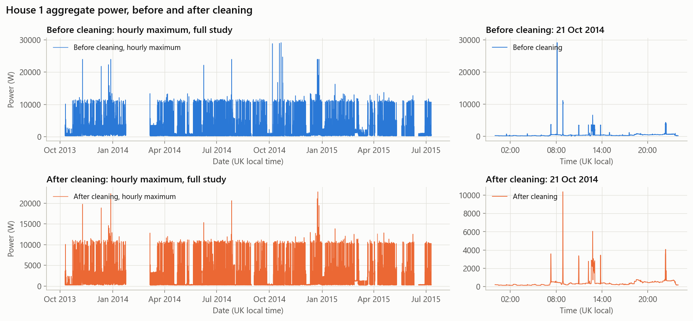
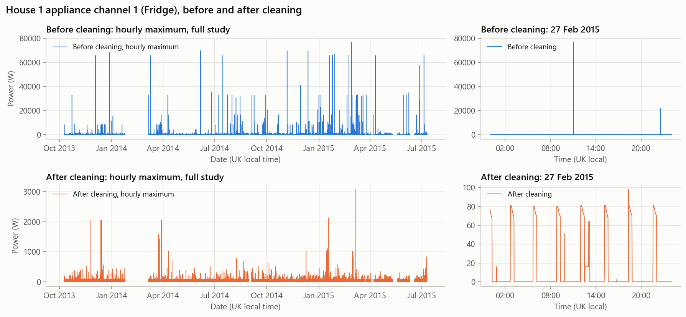
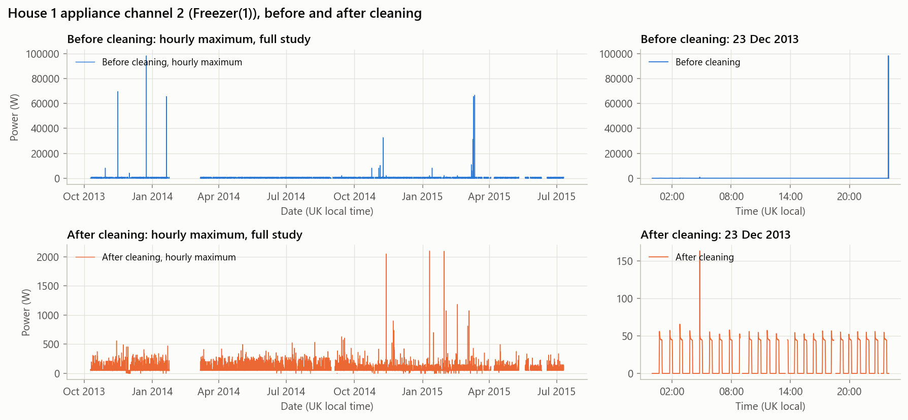
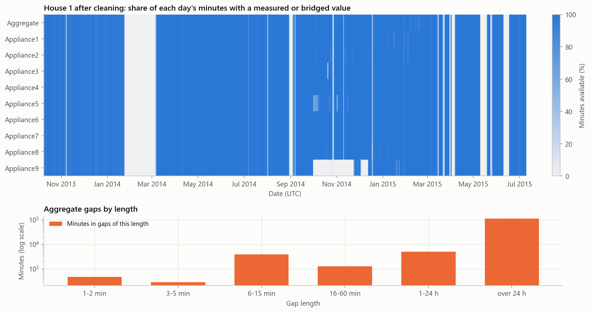
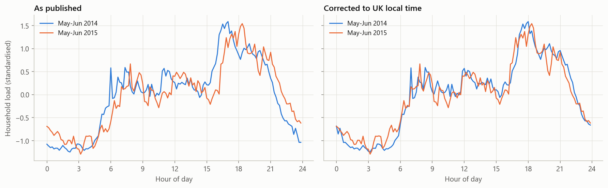

# Data report

## Summary

We cleaned House 1's raw REFIT data into a 1-minute table and checked the result against the official cleaned file. The raw data has real problems: its clock shifts at UK clock changes, about 1 million timestamps are duplicated, and sensors report impossible spikes of up to 98 kW.

| Raw readings | Clean 1-minute table | Short gaps filled | Long outages left empty | Washer agreement with official file |
|---:|---:|---:|---:|---:|
| 8,518,763 | 920,031 minutes | 755 minutes | 122,446 minutes | r = 0.9986 |

The official cleaned files also have problems that affect modelling. The largest: frozen readings make up 30.7% of House 5's published washing-machine energy ([section 7](#7-problems-in-the-official-cleaned-files)).

## 1. The data

| Item | Details |
|---|---|
| Source | REFIT Electrical Load Measurements, University of Strathclyde (Murray et al., 2017) |
| Households | 20, numbered 1-21 with no House 14 |
| Files used | `RAW_House1_Part1.csv` and `Part2.csv`; `CLEAN_House{n}.csv` for every house |
| House 1 raw coverage | 9 Oct 2013 to 10 Jul 2015 (raw clock) |
| Sampling | Median 7 s (the README says 8 s), logged on change |
| Units | Active power in watts |
| Aggregate | Measured by a current clamp, about 6% relative error per the paper |
| Appliances | Nine plug monitors per home, capturing 22-55% of household consumption per the paper. The channel mapping differs by home, so it is read from the README |
| Washing-machine homes | 19 of 20 have at least one such channel; 11 are used (see `RESULTS.md`) |

## 2. Cleaning pipeline

The pipeline is `clean_raw_house1()` in `src/preprocessing.py`. It never changes the raw files. Notebook `01_raw_data_inspection.ipynb` runs it and writes `data/processed/house1_raw_cleaned_1min.parquet`.

## 3. Main problems and fixes

| Problem | Size | Fix | Why |
|---|---|---|---|
| **Clock shifts at UK clock changes** | Jumps of about 1 hour | Convert to true UTC; drop 986 rows from the repeated hour of 26 Oct 2014 | Sorting by the raw clock scrambles an hour each autumn |
| **Part 1 and Part 2 overlap** | About 3 months | Keep Part 1; drop 945,403 Part 2 rows | Part 1 is 0.4-1.2 W from the official file; Part 2 is 17-129.5 W |
| **Duplicate timestamps** | 1,019,159 | Keep the last non-null reading per second; merges 1,016,005 rows | Repeats would get extra weight in a minute's average |
| **Impossible appliance spikes** | 3,228 values above 4 kW | Mark as missing | Values cluster on 8192, 4096, 16384 and 32767, which points to sensor errors |
| **Impossible aggregate readings** | 59 above 23 kW; 8 at exactly 0 W | Mark as missing | 23 kW is 100 A x 230 V, an assumed UK domestic limit. An occupied home should not read 0 W |
| **Frozen aggregate sensor** | 7,511 samples | Identical values for 30+ minutes become missing | An outage in disguise |
| **Change-only logging** | 2,255,728 values | Hold the last reading for up to 2 minutes | Matches the limit in the REFIT paper |

## 4. Before and after

**Cleaning removes aggregate readings above 23 kW, the highest at 29 kW, and keeps the recurring load of about 11 kW.**

**Fridge: spikes up to about 77 kW disappear, revealing the normal on/off cycle.** The y-axes differ between panels so that the cleaned pattern stays visible.

**Freezer: the same result, with spikes of up to 98 kW removed.**

## 5. Handling missing data

**Short gaps are filled; long outages are never invented.** At one reading every 7 s, a 5-minute gap loses about 40 readings, short enough for a straight line to be a fair estimate. The choice barely matters: these gaps are 0.6% of empty minutes.

| Gap length | Gaps | Minutes lost | Action |
|---|---:|---:|---|
| 1-2 min | 366 | 475 | Interpolated and flagged |
| 3-5 min | 77 | 280 | Interpolated and flagged |
| 6-15 min | 342 | 3,932 | Left empty and flagged |
| 16-60 min | 44 | 1,274 | Left empty and flagged |
| 1-24 h | 20 | 5,088 | Left empty and flagged |
| Over 24 h | 12 | 112,152 | Left empty and flagged |

**Gaps over 24 hours hold 91% of empty minutes.** The largest is the February 2014 outage the README mentions.

**Zero is not the same as missing.** A measured zero stays 0, a missing value stays empty, and no new zeros are created. Zeros inherited from Part 1 and the official files cannot always be separated from true zeros, because Part 1 wrote unavailable sensors as 0.

**The 1-minute value is a mean,** because mean power x time gives energy. A median or spot sample would not preserve it.

## 6. Checking the result

We compared the pipeline with the official cleaned file. **This is a consistency check, not an independent test:** the pipeline code does not read the official values, but the official file informed the Part 1 and clock decisions.

| Version, against the official file | Aggregate r | Aggregate MAE | Washer r | Washer MAE |
|---|---:|---:|---:|---:|
| No masking, all files merged | 0.9931 | 8.12 W | 0.9346 | 0.82 W |
| No masking, Part 1 priority | 0.9992 | 4.08 W | 0.9396 | 0.54 W |
| **Our pipeline** | **0.9992** | **3.00 W** | **0.9986** | **0.155 W** |

**The washer channel shows the benefit of cleaning.** Aggregate r barely separates these versions, and nearly all of its gain comes from choosing Part 1.

## 7. Problems in the official cleaned files

These affect anyone using the official files.

1. **The daylight-saving correction stops partway through.** The clock changes behaviour around October 2014, so the same daily routine appears shifted by an hour. `clean_file_true_utc()` fixes this, and the two years then line up:

   

2. **Some zeros are outages.** In House 1, 99.97% of Appliance 9's 7,103 official zero minutes fall where the raw file has no reading. On the washing-machine channel, raw gaps are 1.33% of zero minutes.
3. **Forward-filling creates frozen sensors.** House 5's washing-machine channel holds 2,129 W for 13 hours. Frozen readings are 30.7% of its published energy, so its total is about 44% too high. The other ten homes are at 0.64% or below. Runs of 30+ minutes above 20 W are masked.
4. **One label is misleading.** House 5's "Washing Machine" is an AEG L99695HWD, which retailers sell as a heat-pump washer-dryer.
5. **One channel changes partway through.** The README labels House 13's machine "Changes 25 Mar 2015" without saying what changed. Median event energy shows no visible shift: 0.433 kWh before (392 events), 0.472 kWh after (47 events).

## 8. Remaining concerns

| Concern | Size | Status |
|---|---|---|
| Appliance glitches below 4 kW, such as a 3,072 W fridge reading | Rare | Kept; these channels are not modelled |
| Isolated washing-machine readings of 500 W or more | Up to 2.64% of a home's energy | Kept; small next to the model's error |
| Frozen washing-machine readings under 30 minutes | 63 of 4,377 events, 0.88% of event energy | Kept |
| Zeros that are really outages | 1.33% of House 1 washing-machine zero minutes | Cannot be separated; measured on House 1 only |
| Exact clock-switch date | Established on House 1 only | Affects time-of-day charts slightly |
| Aggregate minutes between 15 and 23 kW | Rare; largest 22,748 W | Kept; cannot be shown to be wrong |
| Rows flagged by the publishers' `Issues` column | 0.26-5.73% of rows; 1.05-13.38% when the machine is on | Kept; `RESULTS.md` compares results with and without them |

## Full details

<strong>House 1 raw inspection: every check</strong>

| Check | Part 1 | Part 2 |
|---|---:|---:|
| Total records | 4,377,877 | 4,140,886 |
| Start (raw clock) | 2013-10-09 14:06:17 | 2014-06-27 21:57:50 |
| End (raw clock) | 2014-10-01 01:27:07 | 2015-07-10 11:56:32 |
| Unparseable timestamps | 0 | 0 |
| Backward time steps | 1 | 0 |
| Duplicate Unix timestamps | 1,004,404 | 14,755 |
| Exact duplicate rows | 595,935 | 0 |
| Duplicates with a different aggregate | 79,519 | 126 |
| Missing values, all channels | 0 | 5,284,083 |
| Missing values, aggregate | 0 | 188,973 |
| Median interval (s) | 7 | 7 |
| 99th percentile interval (s) | 16 | 9 |
| Intervals over 30 s | 1,703 | 3,901 |
| Gaps over 2 minutes | 593 | 122 |
| Gaps over 1 hour | 14 | 19 |
| Negative readings | 0 | 0 |
| Aggregate above 23,000 W | 26 | 51 |
| Aggregate exactly 0 W | 12 | 0 |
| Appliance readings above 4,000 W | 3,038 | 911 |
| Maximum aggregate (W) | 24,000 | 29,159 |
| Maximum appliance reading (W) | 98,301 | 98,301 |

In Part 1, only 56% of steps are 10 s or less; in Part 2, 99% are. The raw `Unix` value jumps back 3,597 s at 27 Oct 2013 and forward 3,605 s at 30 Mar 2014, exactly at UK clock changes. Part 1 has no missing values only because, per the README, unavailable sensors were written as 0.

Counts in section 3 are lower than the raw counts above because rows from the overlap and duplicates are removed first.

<strong>Outliers: why spikes are errors and peaks may be real</strong>

Appliance values above 4,000 W are 0.0055% of appliance readings. The 4 kW limit is the REFIT authors' own.

Aggregate readings above 15 kW occur in 186 rows on 17 days, and the longest run is 18 rows, about 2 minutes. Only those above 23 kW are removed. A recurring band up to about 11 kW is kept because it appears throughout the study and looks like a real large load. An electric shower is one possibility, but no channel records it.

The median conflict between duplicate readings is 3 W.

<strong>Pipeline against the official file: full agreement</strong>

| Channel | Bias | RMSE | Largest difference | Shared minutes | Official only | Pipeline only |
|---|---:|---:|---:|---:|---:|---:|
| Aggregate | -0.012 W | 29.52 W | 7,294 W | 796,706 | 6,947 | 879 |
| Washing machine (Appliance 5) | 0.019 W | 7.31 W | 1,755 W | 792,591 | 11,062 | 912 |

Every channel is in `outputs/metrics/raw_house1_channel_agreement.csv`. Monthly channel correlations are at least 0.996 in the months checked. Compared with the official printed clock, the pipeline's local clock gives only r = 0.7506, because the printed clock changes partway through.

This shows consistency with the publishers' work. It cannot show that both are free of errors.

<strong>Official-file evidence: daylight-saving and zeros</strong>

In all 11 homes used, the 01:00 hour is normal on 30 Mar 2014 (542-600 rows), inflated on 26 Oct 2014 (606-1,057) and empty on 29 Mar 2015.

The paper says gaps over 2 minutes were zero-filled, while the README mentions only forward-filling. In House 1, Appliance 9 normally reads about 1 W, and only 7.4% of its gap minutes are zero, so both treatments occur.

