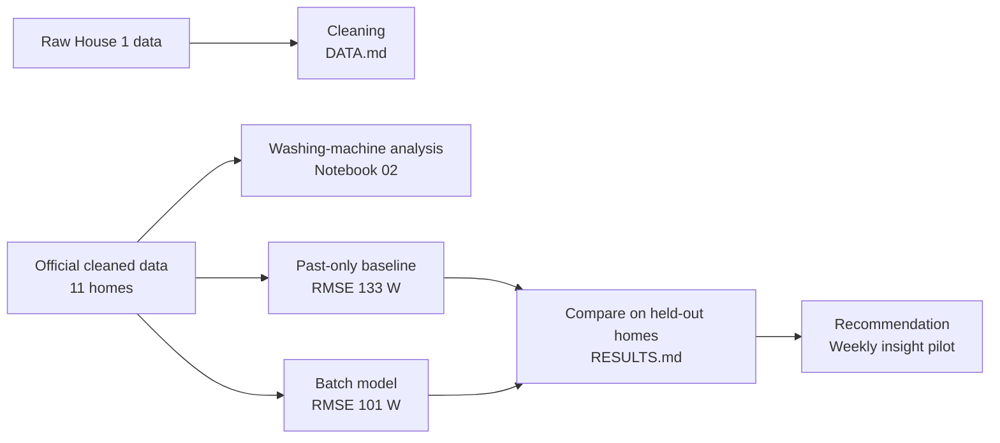

# Washing-machine disaggregation from smart-meter data (REFIT)

## Project overview

This project estimates a washing machine's power from a home's total electricity use, known as Non-Intrusive Load Monitoring (NILM). It includes a pipeline that cleans raw REFIT data, an analysis of washing-machine use across 11 homes, disaggregation models with baselines, and a recommendation for utilities.

We built and evaluated two models. A **past-only model** uses only readings up to the current minute, so it can support live use. A **batch model** also reads later minutes, so it suits reporting after the data is collected. The batch model performed better (RMSE 101 W against 133 W, R² 0.57 against 0.26), so it is our final model. The past-only model remains in this repository with its code, metrics and figures, as the baseline and as the option for live use.



**[View the project dashboard](https://akshat2gupta.github.io/REFIT-NILM/)** for the main results at a glance.

| Document | Contents |
|---|---|
| [`DATA.md`](DATA.md) | Data coverage, quality findings and cleaning decisions |
| [`RESULTS.md`](RESULTS.md) | Washing-machine analysis, model results, experiments, failure cases and references |
| [`Recommendation.md`](Recommendation.md) | One-page summary for a utility |
| [`experiments/README.md`](experiments/README.md) | Optional: the experiments behind the final model. Not needed to run or review the main pipeline |

## Business problem

Utilities measure a home's total consumption, but rarely what each appliance uses. Estimating appliance use without extra meters could support customer insight and energy-saving programmes. This project tests how far that works for washing machines, and what a utility can and cannot rely on.

## Main results

Each of 11 homes was tested with a model trained on the other ten, at 1-minute resolution:

| | RMSE | MAE | R² | Minute-level F1 | Weekly tracking r |
|---|---:|---:|---:|---:|---:|
| **Final model (batch)** | **101 W** | **16.6 W** | **0.57** | **0.53** | **0.78** |
| Past-only baseline | 133 W | 25.1 W | 0.26 | 0.38 | 0.64 |
| Always off | 161 W | 18.7 W | -0.01 | 0.00 | n/a |

**The final model is built for weekly batch insight.** Compared with the past-only baseline, it cuts RMSE by 24% across all 11 homes, more than doubles R² and reduces the share of energy predicted in OFF minutes from 64% to 38%. It also beats always-off on both RMSE and MAE, which the baseline does not. It reads later minutes, so live use relies on the past-only model. Cycle counts and billing would need sub-metered validation first.

## Data and coverage

[REFIT Electrical Load Measurements](https://pureportal.strath.ac.uk/en/datasets/refit-electrical-loadmeasurements/), University of Strathclyde (CC BY 4.0). Power is in watts, sampled about every 7 seconds and resampled to 1 minute. Data is not committed to this repository.

| Task | Data | Homes | Period |
|---|---|---|---|
| Cleaning | Raw | House 1 | Oct 2013 to Jul 2015 |
| Analysis and modelling | Official cleaned | 2, 5, 6, 7, 10, 13, 15, 16, 17, 19, 20 | Sep 2013 to Jul 2015, varying by home |
| Stress test on washer-dryer homes | Official cleaned | 1, 8, 9, 18 | See notebook 03 |

## Repository structure

```text
REFIT-NILM/
├── src/                      Cleaning, event detection, features, models and metrics
│   └── lookahead.py          The final model's features
├── scripts/
│   ├── download_data.py      Downloads and extracts REFIT
│   ├── run_experiments.py    Trains the baselines and past-only models
│   ├── run_final_model.py    Trains the final model
│   ├── evaluate_final_model.py  Final metrics and figures
│   └── evaluate_excluded_homes.py  Stress test on washer-dryer homes
├── notebooks/                01 raw data, 02 washing-machine analysis, 03 baseline modelling
├── outputs/                  Figures and metric tables
├── experiments/regression/   Optional: experiments behind the final model
└── README.md, DATA.md, RESULTS.md, Recommendation.md, requirements.txt
```

## Setup and execution

Python 3.10, on CPU. Allow about 9 GB of disk for data, 0.4 GB for outputs and 16 GB of RAM.

```bash
python -m venv .venv
source .venv/bin/activate              # Windows: .venv\Scripts\activate
pip install -r requirements.txt

python scripts/download_data.py        # Download and extract the data
python scripts/run_experiments.py      # Baselines and past-only models: a few hours
python scripts/run_final_model.py      # Final model: about 15-30 minutes
python scripts/evaluate_final_model.py # Final metrics and figures
python scripts/evaluate_excluded_homes.py # Stress test on washer-dryer homes
```

Then run the notebooks in order: 01, 02, 03. Training scripts resume if interrupted. Results are written to `outputs/metrics/` and `outputs/figures/`.

**Where each step lives**

| Step | Run | Code | Output |
|---|---|---|---|
| Cleaning | Notebook 01 | `src/preprocessing.py` | `DATA.md`, `01_*` figures |
| Washing-machine analysis | Notebook 02 | `src/cycle_detection.py` | `RESULTS.md`, `02_*` figures |
| Baselines | `scripts/run_experiments.py`, notebook 03 | `src/modeling.py` | `03_*` figures, `loho_*` metrics |
| Final model | `scripts/run_final_model.py` | `src/lookahead.py` | `loho__lookahead_ctx__*` predictions |
| Final evaluation | `scripts/evaluate_final_model.py` | `src/evaluation.py` | `04_*` figures, `final_model_*` metrics |
| Stress test | `scripts/evaluate_excluded_homes.py` | `src/lookahead.py` | `final_model_excluded_homes.csv` |
| Dashboard | `scripts/build_dashboard.py` | Saved metric tables | `docs/index.html` |

## Methodology

**Preprocessing decisions.** Full reasons and evidence are in `DATA.md`.

- **Clock:** convert to true UTC, because the raw clock shifts at UK clock changes.
- **Duplicates and overlap:** keep Part 1 where files overlap, and the last non-null reading per second.
- **Invalid readings:** aggregate readings above 23 kW or at 0 W and below, and appliance readings above 4 kW, are masked as missing. A home with always-on appliances should rarely read 0 W in total. Appliance zeros stay as measured.
- **Resampling:** calculate mean power per minute, giving a consistent 1-minute series that preserves energy over complete, evenly sampled intervals.
- **Gaps:** interpolate up to 5 minutes and flag them. Leave longer outages empty and flag them.

**Washing-machine cycles.** The machine is active above 20 W. Pauses up to 15 minutes are joined, and an event must last 10 minutes and reach 200 W. These thresholds identify candidate operating events; they do not confirm that every detected event is a complete wash cycle.

**Final model.** HistGradientBoosting regression with fixed settings, using 86 aggregate-derived features: 34 past-only features, future aggregate readings up to 60 minutes, and cycle-context features such as heating-block position and motor-like variation, some of which can look further ahead. The model estimates washing-machine power at 1-minute resolution and is intended for batch estimation, not live prediction.

## Validation and metrics

**Design.** Leave one house out is primary, because a utility has no appliance data for a customer's home. A temporal split on the baseline is a secondary check. ON/OFF thresholds come from two held-back training homes.

**Leakage.** Whole homes are held out, no feature uses the target, and moving the cycle-context features by 7 days removes their gain. Future aggregate readings do not use the washing-machine sub-meter, but the aggregate includes the machine's own power, so these readings carry information about the target. This is valid for batch estimation, where those readings already exist, but it rules out live prediction. Performance on new homes is tested by holding out each home.

**Baselines.** Always off, average home, a threshold rule, and past-only Random Forest and gradient boosting models.

**Metrics.** RMSE is the main metric, because it punishes missed heating blocks, while MAE alone would reward predicting nothing. We also report R², MAE when ON and OFF, precision, recall, F1, event precision and recall, energy error and weekly tracking.

## Assumptions and trade-offs

**Assumptions**

- The official REFIT README's channel mappings are correct, except where the data shows otherwise.
- The clock switch date of 1 Oct 2014, established on House 1, applies to other homes.
- Aggregate above 23 kW is impossible (100 A x 230 V, an assumed UK domestic limit).
- A reading frozen for 30+ minutes is a fault, not a real load.
- Annualised figures assume missing periods resemble measured ones.

**Trade-offs**

| Choice | Benefit | Cost |
|---|---|---|
| Read future minutes | RMSE improves from 133 W (past-only baseline) to 101 W | Cannot run live; the best past-only experiment, with jitter features, reaches 128 W |
| Trees, not deep learning | Fast and easy to explain | A small CNN was tested on one home only, so a tuned one might do better |
| 1-minute input | Matches the brief | ~8-second input scored better, and is reported only as evidence for finer metering |
| No hyperparameter tuning | Reduces overfitting to test homes | Models may not be at their best |
| Sampled training rows for the final model | Fits in laptop memory | On the baseline features, up to about 1 W RMSE difference by home |

## Limitations and future improvements

**Limitations**

- **Similar loads:** dishwashers and low-heat cycles remain the hardest cases.
- **Generalisation:** model development used these 11 UK homes, with each home held out in testing. On 4 washer-dryer homes not used to choose the final model, RMSE was 102.5 W and R² 0.58, against 134.5 W and 0.28 for the baseline. The next step is validating on new homes, and on local data before use in India.
- **Total energy:** error is similar to the baseline (24% against 22%) and varies by home, from -55% to +57%.
- **Single-home change:** detecting a change in one home is not yet validated, so this is a pilot goal.

**Next steps, in priority order**

| Priority | Next step | Why it matters |
|---:|---|---|
| 1 | Validate on new homes | Gives an independent measure of real-world performance |
| 2 | Simplify the feature set | A smaller model is easier to explain and maintain |
| 3 | Evaluate higher-resolution input | ~8-second data showed a large gain, which could guide meter choices |
| 4 | Benchmark a tuned CNN on all homes | Gives a full comparison, as the first test covered one home |
| 5 | Add per-home calibration | May correct level errors, such as House 15's |
| 6 | Model dishwashers and washers jointly, using each home's own routine | Targets the strongest source of false alarms |
| 7 | Extend to 15- and 30-minute data and low-temperature cycles | Tests the settings most relevant to deployment |
