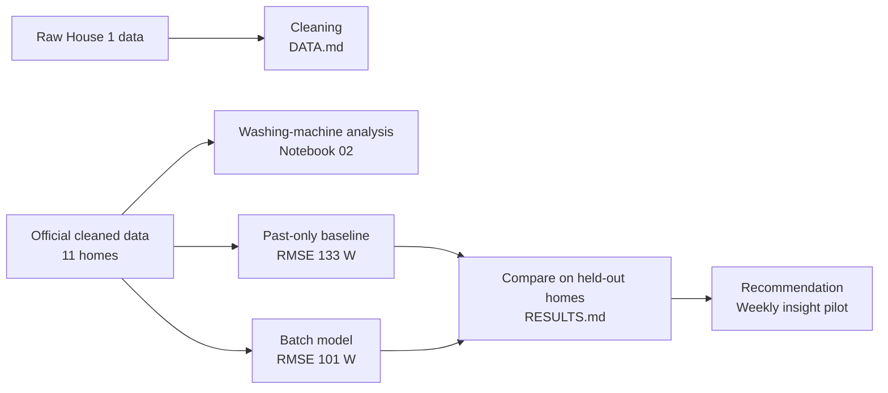

# Washing-machine disaggregation from smart-meter data (REFIT)

## Project overview

This project estimates a washing machine's power from a home's total electricity use, known as Non-Intrusive Load Monitoring (NILM). It includes a pipeline that cleans raw REFIT data, an analysis of washing-machine use across 11 homes, disaggregation models with baselines, and a recommendation for utilities.

We built and evaluated two models. A **past-only model** uses only readings up to the current minute, so it can support live use. A **batch model** also reads later minutes, so it suits reporting after the data is collected. The batch model performed better (RMSE 101 W against 133 W, R² 0.57 against 0.26), so it is our final model. The past-only model remains in this repository with its code, metrics and figures, as the baseline and as the option for live use.



| Document | Contents |
|---|---|
| [`DATA.md`](DATA.md) | Data coverage, quality findings and cleaning decisions |
| [`RESULTS.md`](RESULTS.md) | Washing-machine analysis, model results, experiments, failure cases and references |
| [`Recommendation.md`](Recommendation.md) | One-page summary for a utility |
| [`experiments/README.md`](experiments/README.md) | Optional: the experiments behind the final model. Not needed to run or review the main pipeline |

## Business problem

Utilities measure a home's total consumption, but rarely what each appliance uses. Estimating appliance use without extra meters could support customer insight and energy-saving programmes. This project tests how far that works for washing machines, and what a utility can and cannot rely on.

## Main results

Each of 11 homes was tested with a model trained on the other ten, at 1-minute resolution:

| | RMSE | MAE | R² | Minute-level F1 | Weekly tracking r |
|---|---:|---:|---:|---:|---:|
| **Final model (batch)** | **101 W** | **16.6 W** | **0.57** | **0.53** | **0.78** |
| Past-only baseline | 133 W | 25.1 W | 0.26 | 0.38 | 0.64 |
| Always off | 161 W | 18.7 W | -0.01 | 0.00 | n/a |

**The final model suits batch uses such as weekly reporting.** It reads future minutes, so it cannot run live. It is not accurate enough for exact power, cycle counts or bills: it predicts 1.5 times the true number of events, and 38% of its predicted energy still falls when the machine is off.

## Data and coverage

[REFIT Electrical Load Measurements](https://pureportal.strath.ac.uk/en/datasets/refit-electrical-loadmeasurements/), University of Strathclyde (CC BY 4.0). Power is in watts, sampled about every 7 seconds and resampled to 1 minute. Data is not committed to this repository.

| Task | Data | Homes | Period |
|---|---|---|---|
| Cleaning | Raw | House 1 | Oct 2013 to Jul 2015 |
| Analysis and modelling | Official cleaned | 2, 5, 6, 7, 10, 13, 15, 16, 17, 19, 20 | Sep 2013 to Jul 2015, varying by home |
| Stress test on washer-dryer homes | Official cleaned | 1, 8, 9, 18 | See notebook 03 |

## Repository structure

```text
REFIT-NILM/
├── src/                      Cleaning, event detection, features, models and metrics
│   └── lookahead.py          The final model's features
├── scripts/
│   ├── download_data.py      Downloads and extracts REFIT
│   ├── run_experiments.py    Trains the baselines and past-only models
│   ├── run_final_model.py    Trains the final model
│   └── evaluate_final_model.py  Final metrics and figures
├── notebooks/                01 raw data, 02 washing-machine analysis, 03 baseline modelling
├── outputs/                  Figures and metric tables
├── experiments/regression/   Optional: experiments behind the final model
└── README.md, DATA.md, RESULTS.md, Recommendation.md, requirements.txt
```

## Setup and execution

Python 3.10, on CPU. Allow about 9 GB of disk for data, 0.4 GB for outputs and 16 GB of RAM.

```bash
python -m venv .venv
source .venv/bin/activate              # Windows: .venv\Scripts\activate
pip install -r requirements.txt

python scripts/download_data.py        # Download and extract the data
python scripts/run_experiments.py      # Baselines and past-only models: a few hours
python scripts/run_final_model.py      # Final model: about 15-30 minutes
python scripts/evaluate_final_model.py # Final metrics and figures
```

Then run the notebooks in order: 01, 02, 03. Training scripts resume if interrupted. Results are written to `outputs/metrics/` and `outputs/figures/`. A clean run from a fresh clone has not been timed.

**Where each step lives**

| Step | Run | Code | Output |
|---|---|---|---|
| Cleaning | Notebook 01 | `src/preprocessing.py` | `DATA.md`, `01_*` figures |
| Washing-machine analysis | Notebook 02 | `src/cycle_detection.py` | `RESULTS.md`, `02_*` figures |
| Baselines | `scripts/run_experiments.py`, notebook 03 | `src/modeling.py` | `03_*` figures, `loho_*` metrics |
| Final model | `scripts/run_final_model.py` | `src/lookahead.py` | `loho__lookahead_ctx__*` predictions |
| Final evaluation | `scripts/evaluate_final_model.py` | `src/evaluation.py` | `04_*` figures, `final_model_*` metrics |

## Methodology

**Preprocessing decisions.** Full reasons and evidence are in `DATA.md`.

- **Clock:** convert to true UTC, because the raw clock shifts at UK clock changes.
- **Duplicates and overlap:** keep Part 1 where files overlap, and the last non-null reading per second.
- **Impossible values:** aggregate above 23 kW or exactly 0 W, and appliances above 4 kW, become missing.
- **Resampling:** 1-minute mean, because mean power preserves energy.
- **Gaps:** interpolate up to 5 minutes and flag them. Leave longer outages empty and flag them.

**Washing-machine cycles.** The machine is active above 20 W. Pauses up to 15 minutes are joined, and an event must last 10 minutes and reach 200 W.

**Final model.** HistGradientBoosting regression with fixed settings, on 86 features from the aggregate only: 34 past features, future readings up to 60 minutes, and cycle context, such as the surrounding heating block and motor-like variation.

## Validation and metrics

**Design.** Leave one house out is primary, because a utility has no appliance data for a customer's home. A temporal split on the baseline is a secondary check. ON/OFF thresholds come from two held-back training homes.

**Leakage.** Whole homes are held out, no feature uses the target, and moving the cycle-context features by 7 days removes their gain. Future aggregate readings are not target leakage, because they never contain the washer's own meter. They do limit the model to batch use.

**Baselines.** Always off, average home, a threshold rule, and past-only Random Forest and gradient boosting models.

**Metrics.** RMSE is the main metric, because it punishes missed heating blocks, while MAE alone would reward predicting nothing. We also report R², MAE when ON and OFF, precision, recall, F1, event precision and recall, energy error and weekly tracking.

## Assumptions and trade-offs

**Assumptions**

- The official REFIT README's channel mappings are correct, except where the data shows otherwise.
- The clock switch date of 1 Oct 2014, established on House 1, applies to other homes.
- Aggregate above 23 kW is impossible (100 A x 230 V, an assumed UK domestic limit).
- A reading frozen for 30+ minutes is a fault, not a real load.
- Annualised figures assume missing periods resemble measured ones.

**Trade-offs**

| Choice | Benefit | Cost |
|---|---|---|
| Read future minutes | RMSE improves from 133 W (past-only baseline) to 101 W | Cannot run live; the best past-only experiment, with jitter features, reaches 128 W |
| Trees, not deep learning | Fast and easy to explain | A small CNN was tested on one home only, so a tuned one might do better |
| 1-minute input | Matches the brief | ~8-second input scored better, and is reported only as evidence for finer metering |
| No hyperparameter tuning | Reduces overfitting to test homes | Models may not be at their best |
| Sampled training rows for the final model | Fits in laptop memory | On the baseline features, up to about 1 W RMSE difference by home |
| Reused earlier Random Forest and baseline folds | Saves hours | No full rebuild from scratch; one fold was retrained and matched |

## Limitations and future improvements

**Limitations**

- Similar loads such as dishwashers are hard to separate, and low-heat cycles are hard to see.
- The final inputs were chosen on these same 11 homes, all from one UK area, so scores may be optimistic.
- Total energy is not better than the baseline (24% against 22%), and homes range from -55% to +57%.
- Detecting a change in one home is not validated, and the results should not be transferred to India without local data.

**Next, in order of expected value**

1. **Test on new homes** not used for model choice, because this gives an independent result.
2. **Finish the feature-removal test,** to shrink the 86 features. One of six runs is complete.
3. **Test ~8-second input further,** if meters can report at that rate. The look-ahead version has no shift control yet.
4. **Run the CNN on all homes with tuning,** because one home cannot settle the comparison.
5. **Test a per-home calibration,** which may fix level errors such as House 15's.
6. **Model dishwashers and washing machines jointly,** since dishwashers remain the strongest false-alarm association.
7. **Test the final model at 15 and 30 minutes,** and on low-temperature cycles.
