# Results

| Overview | Analysis | Model | Assessment |
|---|---|---|---|
| [Summary](#summary) | [Homes and periods](#1-homes-and-periods) | [Model and validation](#3-model-and-validation) | [Failure cases](#5-failure-cases) |
| [References](#8-references) | [Washing-machine use](#2-washing-machine-use) | [Results](#4-results) | [Interpretation](#6-interpretation) |
| [Full details](#full-details) | | [What we tried](#what-we-tried-and-why) | [What could be wrong](#7-what-could-be-wrong) |

## Summary

We estimated a washing machine's power from a home's total electricity use at 1-minute resolution, testing each of 11 homes with a model trained on the other ten. **The final model has real skill and suits batch analysis such as weekly reporting. It is not accurate enough for exact minute-level power, cycle counts or bills, and it cannot run live because it reads future minutes.**

| | RMSE | MAE | R² | MAE when ON | Minute-level F1 | Weekly tracking r |
|---|---:|---:|---:|---:|---:|---:|
| **Final model** | **101 W** | **16.6 W** | **0.57** | **219 W** | **0.53** | **0.78** |
| Past-only baseline | 133 W | 25.1 W | 0.26 | 291 W | 0.38 | 0.64 |
| Always off | 161 W | 18.7 W | -0.01 | 405 W | 0.00 | n/a |

| Question | Answer | Evidence |
|---|---|---|
| Does it beat the baselines? | **Yes** | RMSE better in 11 of 11 homes against both; MAE better than always off in 8 of 11 |
| Can it find the minutes the machine is on? | **Moderately** | Precision 0.49, recall 0.66 |
| Can it follow weekly use within a home? | **Strongest result** | r = 0.78 (0.23-0.97 by home) |
| Is it right about total energy? | **Within limits** | 24% mean absolute error by home; 38% of predicted energy still falls in OFF minutes |
| Can it count wash cycles? | **Not reliably** | 1.5 times the true count; event precision 0.57, recall 0.83 |
| Can it run live? | **No** | It needs future readings. The best past-only option has RMSE 128 W |
| Does it work on 15- or 30-minute data? | **Not tested on the final model** | The baseline loses most minute-level skill: R² 0.03 and -0.07 |

## 1. Homes and periods

We use **11 of the 20 homes**, from the official cleaned REFIT files at 1-minute resolution. The other nine were excluded because they would distort the signal or have no usable label.

| Excluded homes | Reason |
|---|---|
| 3, 11, 21 | Solar generation affects the aggregate |
| 1, 8, 9, 18 | A separate washer-dryer adds a near-identical unlabelled load |
| 4 | Two washing-machine channels |
| 12 | No washing-machine channel |

| House | Channel | Start | End | Valid minutes | Availability | Exact zero | Active |
|---|---|---|---|---:|---:|---:|---:|
| 2 | Appliance2 | 2013-09-17 | 2015-05-28 | 663,666 | 74.65% | 94.40% | 4.68% |
| 5 | Appliance3 | 2013-09-26 | 2015-07-06 | 824,378 | 88.31% | 53.53% | 5.26% |
| 6 | Appliance2 | 2013-11-28 | 2015-06-28 | 699,679 | 84.15% | 97.43% | 1.88% |
| 7 | Appliance5 | 2013-11-01 | 2015-07-08 | 766,991 | 86.87% | 74.86% | 8.37% |
| 10 | Appliance5 | 2013-11-20 | 2015-06-30 | 685,126 | 81.06% | 90.23% | 8.72% |
| 13 | Appliance3 | 2014-01-17 | 2015-05-31 | 537,710 | 74.91% | 84.85% | 5.21% |
| 15 | Appliance3 | 2013-12-17 | 2015-07-08 | 699,642 | 85.64% | 96.18% | 2.89% |
| 16 | Appliance5 | 2014-01-10 | 2015-07-08 | 635,080 | 81.13% | 93.32% | 3.70% |
| 17 | Appliance4 | 2014-03-06 | 2015-06-19 | 619,904 | 91.61% | 96.63% | 2.36% |
| 19 | Appliance2 | 2014-03-06 | 2015-06-20 | 629,432 | 92.92% | 86.59% | 3.86% |
| 20 | Appliance4 | 2014-03-20 | 2015-06-23 | 599,939 | 90.52% | 97.21% | 2.42% |

**Missing intervals:** the 11 homes have 5,211 gaps after short gaps of up to 5 minutes are filled, totalling 1,354,936 missing minutes. Each home has 50-934 gaps, and its longest lasts 8.6-62.0 days. Gaps over 24 hours hold most missing time: 63.5-93.5% in 10 homes and 44.1% in House 5. The full table is in `outputs/metrics/household_gap_lengths.csv`.

Exact zero is not the same as OFF: House 5 mostly reads about 3 W on standby, so activity uses a 20 W threshold. Tumble-dryer homes stay in, so the exclusion rule is not perfectly consistent. Cleaning decisions are in `DATA.md`.

## 2. Washing-machine use

### What counts as a cycle

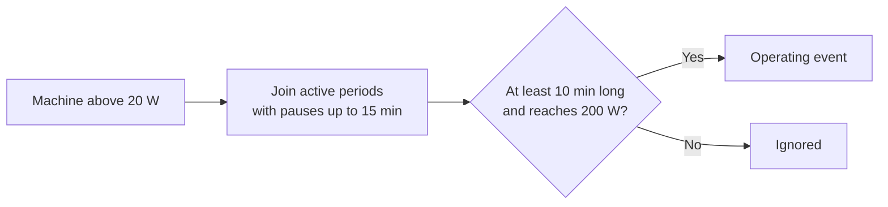

Missing data always ends an event. **This rule finds 4,377 events**, of which 300 are incomplete and left out of per-cycle statistics. The result depends mainly on the pause setting: 5,112 events with a 2-minute pause and 4,126 with 30 minutes. These are events estimated from power, not verified wash cycles.

**A typical complete event** lasts 74 minutes, uses 0.51 kWh and peaks at 2,081 W. Events capture 92.0-99.7% of each home's washing-machine energy.

**Typical cycles are captured well: one heating block of about 2 kW, then lower-power tumbling.** The bottom row shows the rule's limits: House 5's 572-minute event is not one wash, and its lowest-peak event is a frozen sensor.

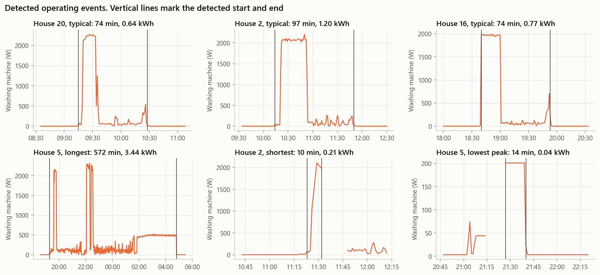

### A typical day

**Other appliances can look like the washer.** In House 2, two washes appear as blocks of about 2 kW, while evening blocks of 2-4 kW look similar with the machine off. This is the model's main difficulty.

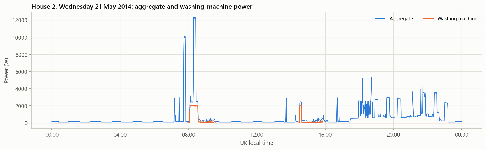

### Differences between homes

**Homes differ far more than cycles do.** Annual energy varies 6 times (55-331 kWh), mostly because of how often the machine runs: events per week and annual energy have a rank correlation of 0.91. Some homes repeat one programme (10, 13, 19), while others vary widely (6, 15).

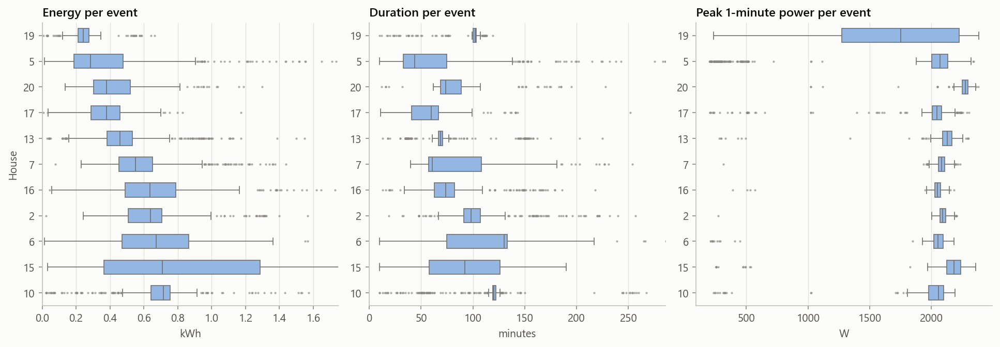

| House | Events | Per week | Median duration (min) | Mean peak (W) | kWh per event | Annual kWh |
|---|---:|---:|---:|---:|---:|---:|
| 2 | 327 | 4.92 | 98 | 2,088 | 0.646 | 158.6 |
| 5 | 733 | 8.95 | 44 | 1,813 | 0.403 | 198.7 |
| 6 | 129 | 1.84 | 130 | 1,895 | 0.667 | 62.1 |
| 7 | 839 | 10.95 | 61 | 2,080 | 0.581 | 330.6 |
| 10 | 606 | 8.11 | 120 | 2,000 | 0.686 | 283.6 |
| 13 | 439 | 7.96 | 69 | 2,093 | 0.491 | 193.2 |
| 15 | 256 | 3.65 | 92 | 2,104 | 0.806 | 150.1 |
| 16 | 309 | 4.81 | 74 | 2,031 | 0.681 | 169.6 |
| 17 | 289 | 4.58 | 60 | 1,907 | 0.374 | 90.9 |
| 19 | 262 | 4.16 | 102 | 1,640 | 0.254 | 55.4 |
| 20 | 188 | 3.04 | 74 | 2,247 | 0.445 | 70.5 |

**Heating dominates energy:** 71.3% of energy arrives in the 15.1% of active minutes at 1000+ W. House 19 is the exception, with 2.7% of active minutes and 28.4% of energy.

### When machines run

**Starts peak in the morning, but homes follow different routines.** House 6 favours about 10:00, House 10 about 19:00, and House 19 late evening.

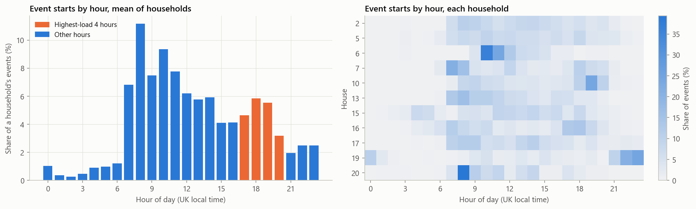

**There is no consistent weekend effect.** Only 4 of 11 homes use the machine more at weekends (p = 0.97). The higher Saturday average comes from a few homes, such as 5 and 13.

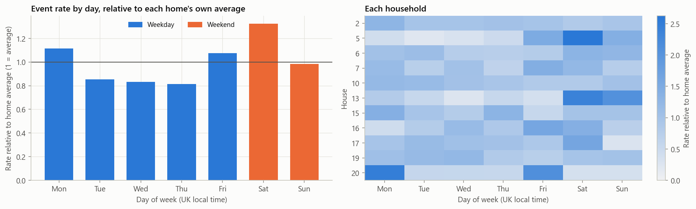

**Peak shifting is not a general opportunity.** At 17:00-21:00, the highest-load window in these homes, the mean share of energy is 18.5% against 16.7% for flat use (p = 1.00). The range is 1.4-45.1%, and three homes hold 68% of that energy.

## 3. Model and validation

| Choice | What we did | Why |
|---|---|---|
| **Target** | Washing-machine watts for each minute | The brief asks for power, and regression keeps the size of the load |
| **Final model** | HistGradientBoosting with fixed settings, on 86 aggregate-only features | Trees handle nonlinear patterns and need no scaling. The model stays easy to explain |
| **Inputs** | The baseline's 34 past features; future readings up to 60 minutes; cycle context such as the height of the surrounding heating block, nearby blocks, motor-like variation and the active stretch | A wash has a shape that only shows once you see what follows the heating |
| **Baselines** | Always off, average home, threshold rule, and the 34-feature past-only model | Any model must beat these to add value |
| **Primary split** | Leave one house out | Matches deployment: a utility has no appliance data for a customer's home |
| **Secondary split, baseline only** | First 70% of each home trains, last 30% tests, with a 2-hour gap | Measures the future of homes already seen |
| **Training rows** | All ON minutes and busy minutes, plus a weighted 1-in-8 sample of quiet OFF minutes | Fits in laptop memory. On the 34 features, it stays within about 1 W RMSE of full data in each home |

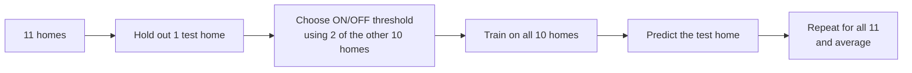

**Why reading the future is valid here.** The brief asks for an estimate from the aggregate and does not require live prediction. Weekly reporting runs after the data is collected, so later readings already exist. These readings do not use the washing-machine sub-meter, but the aggregate includes the machine's own power, so they carry information about the target. This is valid for batch estimation, but it rules out live prediction. Performance on new homes is tested by holding out each home.

**How leakage is prevented:**

1. **Whole homes are held out.** A random split would put overlapping windows from the same home and hour into both training and testing.
2. **No feature uses the target or another appliance.** Replacing the washer signal leaves every feature unchanged (checked on House 16).
3. **The feature labels are honest.** Changing later aggregate values leaves past-only features unchanged and changes look-ahead features, as expected (checked on House 16).
4. **The gain is tied to the current minute.** Moving the cycle-context features by 7 days within each home removes their gain: RMSE is 126.12 W against 125.44 W without them, compared with 101.06 W for the real features.
5. **Thresholds never see the test home.** They come from held-back training homes.

### Metrics

| Metric | What it tells us |
|---|---|
| RMSE and MAE | Average error in watts. RMSE punishes large errors, such as missing a heating block, and is the main metric |
| R² | Skill compared with predicting the home's mean |
| MAE when ON | Error while the machine actually runs |
| Precision, recall, F1 | Whether the model finds the minutes the machine is on |
| Event precision and recall | Whether a utility could count cycles |
| Energy error and weekly r | Whether totals and changes over time are reliable |

## 4. Results

Mean of 11 homes, each tested with a model trained without it.

| Method | MAE (W) | RMSE (W) | R² | MAE when ON (W) | Precision | Recall | F1 | Abs energy error | Weekly r |
|---|---:|---:|---:|---:|---:|---:|---:|---:|---:|
| Always off | 18.73 | 161.30 | -0.01 | 404.80 | 0.00 | 0.00 | 0.00 | 100.00% | n/a |
| Average home | 35.41 | 160.58 | -0.01 | 386.07 | n/a | n/a | n/a | 70.47% | n/a |
| Threshold rule | 60.43 | 186.54 | -0.55 | 399.91 | 0.21 | 0.56 | 0.30 | 231.99% | 0.44 |
| Random Forest, past only | 25.48 | 134.43 | 0.25 | 292.23 | 0.31 | 0.64 | 0.39 | 21.99% | 0.61 |
| Gradient boosting, past only | 25.08 | 133.41 | 0.26 | 290.73 | 0.29 | 0.65 | 0.38 | 22.18% | 0.64 |
| **Final model** | **16.60** | **101.06** | **0.57** | **218.72** | **0.49** | **0.66** | **0.53** | 23.64% | **0.78** |

**The final model beats the past-only baseline on every main metric except total energy.** Its advantage over always off on overall MAE is smaller and less certain.

| Final model against | Metric | Final | Other | Mean difference (95% interval) | Homes better | p |
|---|---|---:|---:|---:|---:|---:|
| Past-only baseline | RMSE | 101.06 | 133.41 | -32.35 (-39.56 to -24.77) | 11 of 11 | 0.001 |
| Past-only baseline | MAE | 16.60 | 25.08 | -8.48 (-10.63 to -6.49) | 11 of 11 | 0.001 |
| Past-only baseline | MAE when ON | 218.72 | 290.73 | -72.01 (-97.56 to -48.00) | 10 of 11 | 0.002 |
| Always off | RMSE | 101.06 | 161.30 | -60.24 (-77.28 to -42.94) | 11 of 11 | 0.001 |
| Always off | MAE | 16.60 | 18.73 | -2.12 (-4.23 to -0.34) | 8 of 11 | 0.054 |
| Always off | MAE when ON | 218.72 | 404.80 | -186.07 (-242.05 to -131.29) | 11 of 11 | 0.001 |

### Actual versus predicted

**The final model reaches much more of the heating block, but false alarms remain on similar loads.** House 16, the same day as the baseline's example, with the home held out of training.

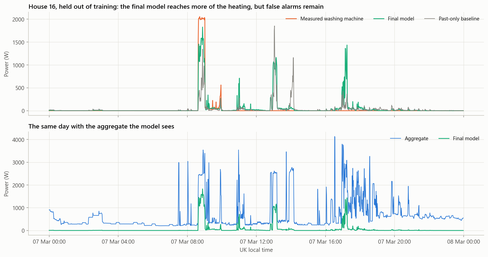

**Heating minutes move closer to the perfect-prediction line, though the spread stays wide.** Minutes measured near 2,000 W still receive a wide range of predictions, and some OFF minutes are predicted high.

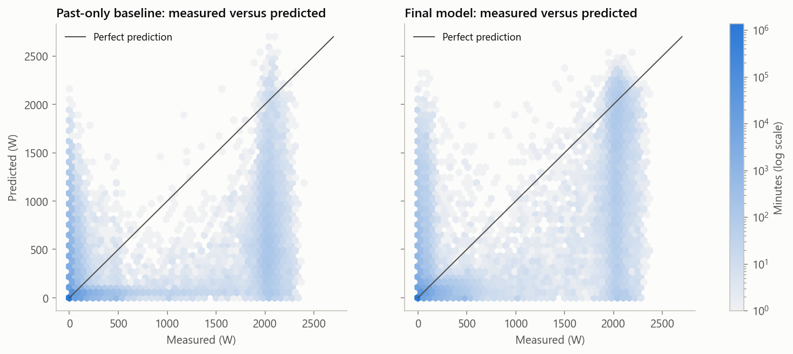

### Where the energy goes

**False energy in OFF minutes almost halves, and heating moves from about one-third to nearly three-fifths of its measured energy.** The model still underestimates heating, so a low total-energy error should not be read as proof that cycles are found.

| Machine state | Measured kWh | Final model kWh | Past-only baseline kWh |
|---|---:|---:|---:|
| Heating, 1000+ W | 1,688.6 | **976.1** | 554.5 |
| 200-1000 W | 224.3 | 60.3 | 44.0 |
| Tumbling, 20-200 W | 371.3 | 414.0 | 268.6 |
| OFF, 20 W or less | 25.1 | **778.0** | 1,423.1 |

Mean predicted power in heating minutes rises from 612 W to 1,083 W, against about 2,000 W measured. Why the model still falls short: when it is unsure, squared error rewards a value between 0 and 2,000 W.

### Results by home

**RMSE improves in every home, and weekly tracking in nearly all.** House 5 is the clear exception: weekly r falls from 0.41 to 0.23.

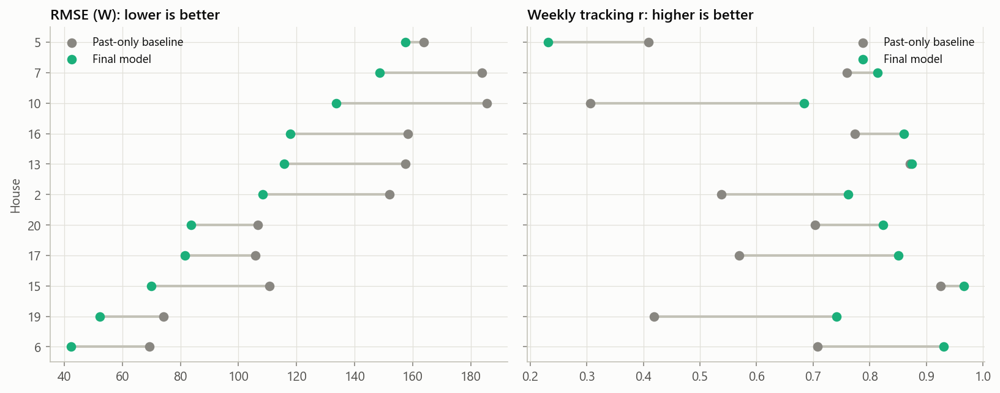

| House | RMSE (W) | R² | MAE when ON (W) | F1 | Signed energy error | Weekly r |
|---|---:|---:|---:|---:|---:|---:|
| 2 | 108.43 | 0.60 | 220.99 | 0.44 | -11.28% | 0.76 |
| 5 | 157.56 | 0.17 | 354.29 | 0.35 | -54.68% | 0.23 |
| 6 | 42.25 | 0.83 | 109.81 | 0.51 | +56.61% | 0.93 |
| 7 | 148.61 | 0.63 | 205.57 | 0.61 | +33.30% | 0.81 |
| 10 | 133.68 | 0.64 | 201.60 | 0.64 | +0.85% | 0.68 |
| 13 | 115.70 | 0.61 | 232.58 | 0.59 | -2.51% | 0.87 |
| 15 | 70.07 | 0.83 | 213.19 | 0.81 | -25.86% | 0.97 |
| 16 | 117.89 | 0.58 | 280.29 | 0.47 | +5.86% | 0.86 |
| 17 | 81.51 | 0.59 | 237.07 | 0.60 | -11.80% | 0.85 |
| 19 | 52.23 | 0.34 | 118.96 | 0.32 | -28.48% | 0.74 |
| 20 | 83.72 | 0.48 | 231.58 | 0.51 | -28.80% | 0.82 |

### What we tried, and why

**Better inputs mattered far more than other losses or a neural network.** Every experiment uses the same 11 homes and leave-one-house-out design. To be kept, a change had to improve both RMSE and MAE when ON in at least 8 of 11 homes, with a 95% interval that excludes zero, without increasing the share of energy in OFF minutes.

| Model | RMSE (W) | MAE (W) | R² | Decision | Why |
|---|---:|---:|---:|---|---|
| **Look-ahead with cycle context (final model)** | **101.06** | 16.60 | **0.573** | **Selected** | Lowest 1-minute RMSE; passes the rule |
| All 148 past, future and context features | 101.84 | 16.40 | 0.569 | Rejected | No better than the smaller set |
| Final features, ON/OFF then power | 101.58 | **15.87** | 0.564 | Rejected | Same RMSE within noise; fails the rule |
| Final features, four power states | 118.82 | 16.81 | 0.375 | Rejected | Much worse RMSE |
| 120-minute look-ahead | 125.24 | 23.22 | 0.330 | Rejected | Almost no gain over 60 minutes |
| 60-minute look-ahead | 125.44 | 23.18 | 0.326 | Rejected | Far behind cycle context |
| Past-only with jitter features | 128.06 | 22.44 | 0.326 | **Live option** | Best past-only set, but fails the rule |
| Past-only with all extra features | 129.47 | 22.46 | 0.317 | Rejected | No better than jitter alone |
| Past-only with hour and day | 132.78 | 25.04 | 0.282 | Rejected | No clear gain |
| Past-only with 3-hour windows | 134.90 | 25.15 | 0.239 | Rejected | Worse than the control |
| Final features, log target | 137.26 | 15.70 | 0.251 | Rejected | Heating badly under-predicted |
| Linear model (Ridge) | 150.78 | 32.86 | 0.090 | Rejected | Much worse |
| Final features, absolute-error loss | 161.30 | 18.73 | -0.013 | Rejected | Collapses to always off |
| Final features, Poisson loss | n/a | n/a | n/a | Failed run | Predictions overflowed, so not a fair test |

**A small Seq2Point CNN was tested on one home only.** On House 16, it reached RMSE 136.54 W using 60 minutes either side, against 117.89 W for the final model, and 163.99 W using the past only, against 161.61 W for the past-only model with jitter features. It took about 30 minutes per fold and looked unlikely to change the decision, so the full run was not pursued. One untuned fold cannot show that a CNN is worse in general.

**Not finished:** removing the five block-shape features barely changed the result (RMSE 101.33 W). The other parts of this feature-removal test were not completed, so we cannot say which features matter most or how far the 86 could shrink.

**The full table of 33 runs is in `outputs/metrics/experiments_summary.csv`,** and `experiments/README.md` explains how to run them.

### Beyond the brief: 8-second input

**Finer data performed better than any 1-minute model at the same task.** These models add within-minute statistics from the ~8-second aggregate, so they fall outside the brief's 1-minute scope and are not candidates for the final model.

| Model | Input | Future data? | RMSE (W) | MAE (W) | R² | Weekly r |
|---|---|---|---:|---:|---:|---:|
| Final model | 1-minute | Yes | 101.06 | 16.60 | 0.573 | 0.776 |
| Past-only with jitter features | 1-minute | No | 128.06 | 22.44 | 0.326 | 0.695 |
| Past-only with within-minute statistics | ~8-second | No | 106.88 | 16.51 | 0.529 | 0.704 |
| Look-ahead with within-minute statistics | ~8-second | Yes | 91.21 | 13.36 | 0.660 | 0.763 |

The past-only gain disappears when these statistics are moved by 7 days (RMSE 134.31 W). No separate check of this kind was run on the look-ahead version.

### Coarser meter data

**Minute-level detail is lost at 15 and 30 minutes, while weekly tracking degrades more slowly.** These results use the past-only gradient boosting baseline, because the final model was not tested at these rates. Events were not scored either.

| Resolution | R² | Mean abs energy error | Weekly r | Weekly error | Homes beating fixed-share r |
|---|---:|---:|---:|---:|---:|
| 1 minute | 0.26 | 22.2% | 0.635 | 36.5% | 11 of 11 |
| 15 minutes | 0.03 | 27.6% | 0.564 | 42.2% | 10 of 11 |
| 30 minutes | -0.07 | 34.9% | 0.541 | 47.8% | 9 of 11 |

## 5. Failure cases

### Case 1: other heating appliances still cause false alarms

**False alarms shrink but do not disappear.** False-alarm energy in Houses 6 and 20 is 30 and 11 kWh, against 81 and 83 kWh of measured washer energy. Dishwashers remain the strongest association: they are running far more often during false alarms than chance would suggest. Other sub-meters were used only for this analysis and are never model inputs.

| Appliance | House 6: share of false-alarm energy (above chance) | House 20: share of false-alarm energy (above chance) |
|---|---:|---:|
| Dishwasher | 15.4% (33 times) | 29.9% (56 times) |
| Kettle | 18.7% (13 times) | 4.6% (6 times) |
| Tumble dryer | Not monitored | 18.0% (12 times) |

This shows co-occurrence, not proof of cause, in two homes first chosen for the baseline's poor scores. Always-on loads such as a computer or freezer also overlap with false alarms, but at about the rate chance predicts. In 25-28% of false-alarm energy, no monitored appliance is above 100 W, so unmetered loads are involved too.

### Case 2: low-heat cycles and atypical machines

**On these typical events, the model captures only a fraction of the measured energy.** House 19's cycles have little heating, with about 100 W of tumbling under a noisy background. In House 5, the machine's 2 kW block sits among other large loads of 2-4 kW.

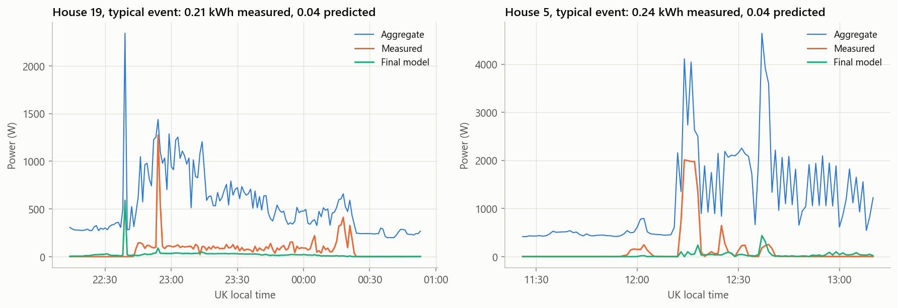

| House | R² | F1 | Signed energy error | Weekly r | Known context |
|---|---:|---:|---:|---:|---|
| 19 | 0.34 | 0.32 | -28.48% | 0.74 | Its median cycle has only 2 heating minutes |
| 5 | 0.17 | 0.35 | -54.68% | 0.23 | Retailers sell this model as a heat-pump washer-dryer |

**This matters for energy advice:** if House 19's cycles are low-temperature, which the data cannot confirm, the model would be weakest on homes already following that advice. House 5's cause is not established.

## 6. Interpretation

**The main limit is ambiguity in the signal, not the choice of algorithm.** Other appliances also draw about 2 kW, so a short view of the aggregate often cannot tell them apart. Seeing what happens around each minute resolves much of this. This is why better inputs moved results far more than other losses did.

**The model works best as a weekly batch tool.** It finds real washes and follows weekly use in most homes, but it still under-predicts heating and places some energy in OFF minutes. So it can support trends, but not exact power, cycle counts or bills.

**Results depend on the home.** R² reaches 0.83 in Houses 6 and 15, but only 0.34 in House 19 and 0.17 in House 5. House 19's cycles have little heating, while the cause in House 5 is not established. A utility should expect this spread, and should validate on its own homes before relying on the model.

## 7. What could be wrong

- **The final inputs were chosen using these same 11 homes.** No eligible home remains unseen, so these scores may be somewhat optimistic. An independent test needs new homes.
- **Homes with a second washing load were not tested on the final model.** The baseline's energy error in those homes was 67.5%, against 21.3% in eligible homes, and a utility cannot easily identify them.
- **Look-ahead limits use:** the final model suits batch reporting only. A live service would rely on a much weaker model.
- **Total energy is not better than the baseline:** 23.6% against 22.2%, and homes range from -55% to +57%.
- **Detecting a change in one home is not validated.** Weekly r shows the model moves with real use, not that it can detect a small change.
- **Small sample:** with 11 homes and many tests, p-values are indications only, and none are corrected for multiple comparisons.
- **One region:** all homes come from one UK area, and they are not a representative sample.
- **Event settings** were chosen looking at all homes, including test homes.
- **Published results are not directly comparable,** because they use different data, sampling rates, splits and metrics.

## 8. References

| Source | Data | What we used | What we found | How much we read |
|---|---|---|---|---|
| Murray, Stankovic and Stankovic (2017). *An electrical load measurements dataset of United Kingdom households from a two-year longitudinal study.* Scientific Data 4:160122. [doi:10.1038/sdata.2016.122](https://doi.org/10.1038/sdata.2016.122) | REFIT | 4 kW spike limit, 2-minute hold, solar exclusions, known issues | Adopted | Full article summary |
| Zhang, Zhong, Wang, Goddard and Sutton (2018). *Sequence-to-point learning with neural networks for non-intrusive load monitoring.* AAAI. [doi:10.1609/aaai.v32i1.11873](https://doi.org/10.1609/aaai.v32i1.11873) | UK-DALE, REDD | 20 W ON threshold, unseen-home testing, MAE plus energy; Seq2Point CNN; a window that sees both sides of the target | Metrics adopted. A smaller CNN was tested on one home and not adopted. The idea of reading future minutes shaped the final model | Full-text summary |
| Precioso and Gómez-Ullate (2020). *NILM as a regression versus classification problem: the importance of thresholding.* [arXiv:2010.16050](https://arxiv.org/abs/2010.16050) | UK-DALE | Regression compared with classification; threshold choice | Kept regression for power, as their classifier-derived washer power had higher MAE | Full-text summary |
| Shin, Joo, Yim, Lee, Moon and Rhee (2018). *Subtask gated networks for non-intrusive load monitoring.* [arXiv:1811.06692](https://arxiv.org/abs/1811.06692) | REDD, UK-DALE | ON/OFF gate multiplied by a power estimate | Tested as a tree-based hurdle model. No clear gain | Full-text summary |
| Ombiro (2026). *What matters in classical machine learning for non-intrusive load monitoring?* Preprint, [arXiv:2611.00920](https://arxiv.org/abs/2611.00920) | REFIT, ~8 s | Comparing past-only and centred inputs on unseen homes | Reports washer F1 of 0.474 (XGBoost), 0.632 (past-only CNN) and 0.663 (centred CNN). Not comparable with our 1-minute results | Full-text summary, most of the paper |
| Petralia, Charpentier, Boniol and Palpanas (2023). *Appliance detection using very low-frequency smart meter time series.* ACM e-Energy. [doi:10.1145/3575813.3595198](https://doi.org/10.1145/3575813.3595198) | Includes REFIT | Signature loss at coarse sampling | Informed the 15/30-minute answer | Part of the paper |
| Hart (1992). *Nonintrusive appliance load monitoring.* Proceedings of the IEEE 80(12). [doi:10.1109/5.192069](https://doi.org/10.1109/5.192069) | n/a | Problem framing only | Background | Citation only |
| Makonin and Popowich (2015). *Nonintrusive load monitoring (NILM) performance evaluation.* Energy Efficiency 8. [doi:10.1007/s12053-014-9306-2](https://doi.org/10.1007/s12053-014-9306-2) | n/a | Awareness of metric choice only | Background | Publisher page only |
| Klemenjak and Goldsborough (2016). *Non-intrusive load monitoring: a review and outlook.* [arXiv:1610.01191](https://arxiv.org/abs/1610.01191) | n/a | Review of methods | Background | Abstract only |

The cycle-context and within-minute features are our own design, drawn from examining this data.

## Full details

<strong>Past-only baseline: results for each home</strong>

"Selected" uses the model chosen for each fold, by RMSE on two held-back homes: gradient boosting won 8 of 11, narrowly (149.6 against 150.7 W).

| House | R² | MAE when ON (W) | Precision | Recall | F1 | Signed energy error | Events true / predicted | Event recall | Event precision |
|---|---:|---:|---:|---:|---:|---:|---:|---:|---:|
| 2 | 0.22 | 281.78 | 0.23 | 0.30 | 0.26 | 26.00% | 318 / 2,052 | 0.92 | 0.23 |
| 5 | 0.10 | 353.28 | 0.21 | 0.56 | 0.30 | -17.10% | 736 / 3,802 | 0.95 | 0.18 |
| 6 | 0.52 | 206.08 | 0.16 | 0.90 | 0.27 | 75.95% | 129 / 2,327 | 0.98 | 0.05 |
| 7 | 0.43 | 281.61 | 0.40 | 0.86 | 0.55 | 12.48% | 835 / 2,634 | 1.00 | 0.30 |
| 10 | 0.31 | 280.87 | 0.33 | 0.83 | 0.48 | -12.61% | 596 / 2,565 | 0.99 | 0.22 |
| 13 | 0.28 | 309.56 | 0.34 | 0.95 | 0.50 | -1.97% | 443 / 1,573 | 1.00 | 0.24 |
| 15 | 0.55 | 385.81 | 0.74 | 0.71 | 0.72 | -56.66% | 247 / 401 | 0.94 | 0.61 |
| 16 | 0.25 | 391.09 | 0.23 | 0.64 | 0.34 | 6.91% | 312 / 2,140 | 0.99 | 0.16 |
| 17 | 0.31 | 308.09 | 0.28 | 0.66 | 0.39 | 2.01% | 286 / 1,466 | 0.98 | 0.19 |
| 19 | -0.33 | 138.41 | 0.23 | 0.22 | 0.23 | 11.27% | 266 / 1,098 | 0.91 | 0.26 |
| 20 | 0.15 | 274.59 | 0.16 | 0.49 | 0.24 | 11.85% | 188 / 1,715 | 0.97 | 0.13 |

<strong>Past-only baseline: uncertainty and chance test</strong>

| Metric | Selected (95% interval) | Compared with | Baseline | Homes better | Wilcoxon p |
|---|---:|---|---:|---:|---:|
| RMSE (W) | 134.0 (110.6 to 156.8) | Always off | 161.3 | 10 of 11 | 0.003 |
| MAE when ON (W) | 291.9 (249.1 to 330.9) | Always off | 404.8 | 11 of 11 | 0.001 |
| MAE (W) | 25.2 (18.1 to 32.4) | Always off | 18.7 | 1 of 11 | 0.003 |
| F1 | 0.389 (0.307 to 0.480) | Threshold rule | 0.298 | 10 of 11 | 0.005 |
| Abs energy error % | 21.3 (9.6 to 36.1) | Average home | 70.5 | 8 of 11 | 0.067 |

Intervals come from resampling homes. **Chance test:** comparing predictions with the machine's power from about 13 days away, F1 falls from 0.389 to 0.062 and R² from 0.25 to -0.34.

<strong>Cycle counting under different rules</strong>

True events must peak at 200 W or more, so the headline applies the same peak rule to predicted events. Results vary by home: recall is 0.35 in House 19 and 0.64 in House 5. The tables are diagnostics that use test labels, and they were not used for tuning. The saved table is `outputs/metrics/final_model_event_rules.csv`.

**Final model**

| Rule for predicted events | Predicted / true | Precision | Recall |
|---|---:|---:|---:|
| Calibrated threshold only | 2.41x | 0.42 | 0.88 |
| **Peak at least 200 W, the same as true events** | **1.50x** | **0.57** | **0.83** |
| Peak at least 500 W | 1.04x | 0.73 | 0.77 |

**Past-only baseline**

| Rule | Predicted / true | Precision | Recall |
|---|---:|---:|---:|
| Calibrated threshold, peak above it | 5.0x | 0.235 | 0.968 |
| Calibrated threshold, peak >= 200 W | 2.9x | 0.318 | 0.867 |
| Calibrated threshold, peak >= 500 W | 1.9x | 0.412 | 0.777 |
| Threshold 200 W, peak >= 800 W | 1.06x | 0.489 | 0.484 |

<strong>Past-only baseline: other analyses</strong>

**Weekly energy against a fixed share of the home's total:** absolute error 36.0% against 60.4% (better in 9 of 11 homes, p = 0.0098), within-home r 0.61 against 0.42 (better in 11 of 11, p = 0.001). The model also beats the threshold rule (0.61 against 0.44, 10 of 11, p = 0.002). A 1 kWh true change moved the prediction by about 0.52 kWh, from 0.17 in House 10 to 0.89 in House 7.

**Known versus unseen homes,** on identical minutes: F1 0.38 to 0.41, R² 0.27 to 0.36, 7 of 11 homes improving (p = 0.083). Having seen a home helps only a little, which suggests ambiguity in the signal is the main limit.

**Rows flagged by the publishers** are 3.24% of minutes but 23.7% of measured machine energy on average, up to 51.5%. So the README's advice to discard them would remove much of what is being measured, and they are kept. Mean R² falls from 0.25 to 0.02 without them, but this comes from House 19 alone: the median moves only from 0.28 to 0.26.

**Stress test on homes with a second washing load** (houses 1, 8, 9, 18): R² 0.27 against 0.25, precision 0.18 against 0.30, absolute energy error 67.5% against 21.3%. Energy error ranges from -0.8% (House 8) to +178.4% (House 18), with a median of 45.3%. House 6, with one machine, reaches +76%, so the error cannot be attributed to the second load alone.

**Training details:** model selection used a 1.5M-row sample and a 50-tree forest. The final model's training code reproduced the experiment's predictions exactly in all 11 homes.

<strong>How far the events can be trusted</strong>

102 events last over 3 hours and 18 over 5 hours (16 of those in House 5). 563 events (12.9%) start 16-60 minutes after another, from 1.1% in House 19 to 25.3% in House 13, so consecutive loads and split cycles cannot be told apart. 308 events have no minute at 1000+ W, 130 of them in House 5. House 5's "Washing Machine" is sold by retailers as a heat-pump washer-dryer; removing it from the baseline barely changes results (F1 0.39 to 0.40). More occupants go with more frequent use (rho 0.68, p = 0.022), but not with more energy per event (rho -0.08).

